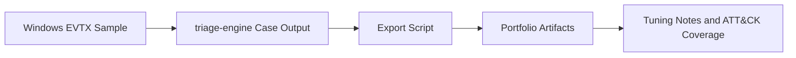
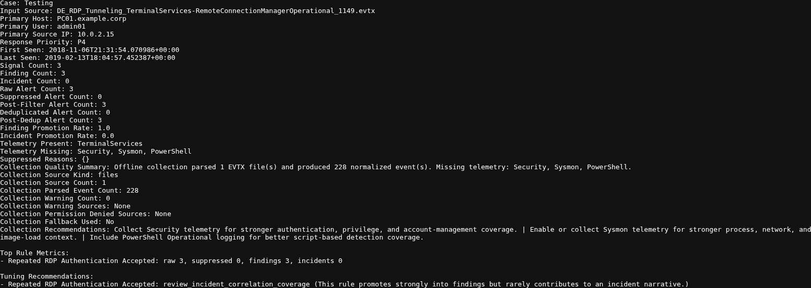
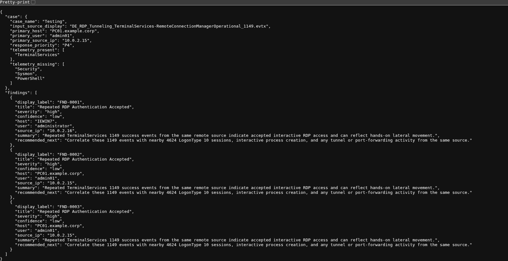
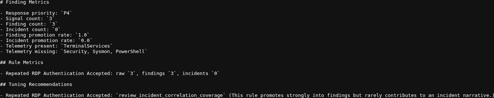

# Detection Engineering and Tuning Lab

A rule for repeated accepted RDP logons (Terminal Services event 1149, ATT&CK T1021.001), run on a sample EVTX file with my [triage-engine](https://github.com/oasunsec/triage-engine). It produced three findings and no incidents. Security, Sysmon and PowerShell logs were missing from the sample, so there was nothing to correlate the findings with. Below is how the rule works, what the case showed, and why I kept the rule instead of suppressing it.

## Setup

- Kali Linux VM on VMware
- Source data: `DE_RDP_Tunneling_TerminalServices-RemoteConnectionManagerOperational_1149.evtx`
- Detection engine: local `triage-engine` case output
- Tools: `jq`, Bash

## Case details

| Field | Value |
|---|---|
| Case name | `Testing` |
| Host | `PC01.example.corp` |
| User | `admin01` |
| Source IP | `10.0.2.15` |
| Priority | `P4` |
| Signals / findings / incidents | 3 / 3 / 0 |
| Telemetry present | `TerminalServices` |
| Telemetry missing | `Security`, `Sysmon`, `PowerShell` |

## The rule

- Event source: TerminalServices RemoteConnectionManager
- Event ID: `1149` (RDP authentication accepted)
- Group by: host, user, and source IP
- Window: two hours
- Threshold: two or more accepted logons
- ATT&CK: `T1021.001`

The rule is kept deliberately small so each result can be checked against the raw events.

## Findings

| ID | Finding | Severity | Evidence | Response |
|---|---|---|---|---|
| D-01 | Repeated `1149` success events from one source were grouped into RDP findings | High | `case-summary.txt`, `detection-snapshot.json`, `timeline.csv` | Keep the rule visible. An accepted RDP logon matters even before anything else corroborates it |
| D-02 | Missing `Security`, `Sysmon`, and `PowerShell` logs lowered confidence and left nothing to pivot to | Medium | `case-summary.txt`, `finding-metrics.md`, `incident-brief.md` | Collect these so the rule can correlate with `4624`, process creation, and script activity |
| D-03 | Three findings and zero incidents: the gap is in correlation, not in the rule | Medium | `finding-metrics.md`, `incident-brief.md` | Build the adjacent correlations before considering suppression |

## Tuning decision

I kept "Repeated RDP Authentication Accepted" as a standalone finding and did not downgrade it.

- An accepted interactive RDP logon is worth an analyst's attention.
- The problem in this case was missing telemetry. Nothing showed the hits were false positives.
- Suppressing the rule before jump hosts, admin workstations and approved maintenance paths are documented would hide activity that might matter.

So the fix is to add correlation. Suppression can wait.

[artifacts/local-tuning-example.json](./artifacts/local-tuning-example.json) shows what a suppression would look like once an admin jump host is documented and approved. I did not apply it to this case.

## Evidence

Case summary with promotion counts and missing telemetry:

Detection snapshot with the findings built from repeated `1149` events:

Finding metrics: three findings, zero incidents, and the correlation recommendation:

## Next

- Add Security `4624` LogonType `10` to confirm that a session was created.
- Add Sysmon process and network events for the same host and source IP.
- Correlate repeated `1149` findings with other lateral-movement signals before adding any suppression.

## Files

Artifacts:

- [artifacts/case-summary.txt](./artifacts/case-summary.txt)
- [artifacts/finding-metrics.md](./artifacts/finding-metrics.md)
- [artifacts/timeline.csv](./artifacts/timeline.csv)
- [artifacts/detection-snapshot.json](./artifacts/detection-snapshot.json)
- [artifacts/incident-brief.md](./artifacts/incident-brief.md)
- [artifacts/local-tuning-example.json](./artifacts/local-tuning-example.json)

Notes and scripts:

- [notes/detection-logic.md](./notes/detection-logic.md)
- [notes/tuning-notes.md](./notes/tuning-notes.md)
- [mitre/coverage.md](./mitre/coverage.md)
- [scripts/export_case_artifacts.sh](./scripts/export_case_artifacts.sh)

`./scripts/export_case_artifacts.sh` reads from `../../triage-engine/cases/Testing` by default. Pass a different case directory as the first argument.
