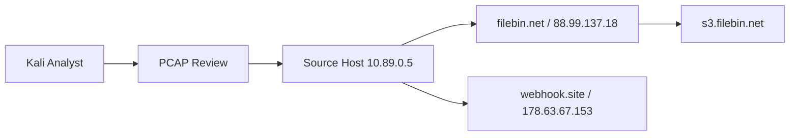
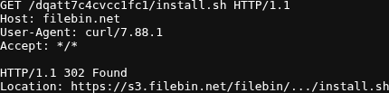
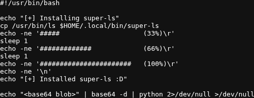
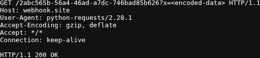

# Project: SOC Homelab Investigation

## Executive Summary

This project presents a SOC network investigation using packet capture evidence from a Linux host. The analysis identified a curl download of install.sh from filebin.net, retrieval of a payload from s3.filebin.net, and subsequent outbound communication to webhook.site using python-requests. Decoding that request showed the payload stole the host's environment variables, including an API key. The write-up includes triage notes, indicators of compromise, ATT&CK mapping, and a final assessment.

## Environment

- Host: VMware
- Analyst VM: Kali Linux
- Evidence source: packet capture from a Linux system
- Network: lab review of captured traffic
- Tools: Wireshark, `tshark`, `tcpdump`, Nmap, ATT&CK Navigator

## Case Snapshot

- Internal source IP: `10.89.0.5`
- External IPs: `88.99.137.18`, `178.63.67.153`
- Domains: `filebin.net`, `s3.filebin.net`, `webhook.site`
- Capture window: February 3, 2025 14:26:57 to 14:27:00
- Artifact: [artifacts/2025-02-03_suspicious-http-download.pcap](./artifacts/2025-02-03_suspicious-http-download.pcap)

## Topology

## Investigation Workflow

1. Host `10.89.0.5` requests `/dqatt7c4cvcc1fc1/install.sh` from `filebin.net` with `curl/7.88.1`
2. The server issues an HTTP `302` redirect to `s3.filebin.net`
3. The host downloads `install.sh`
4. The script contains a Base64-decoded Python payload
5. The Python code sends encoded environment data to `webhook.site`
6. Decoding the `?x=` parameter recovers the stolen environment, including an `API_KEY`

The sequence is consistent with suspicious script retrieval followed by outbound data transfer.

## Decoding the Exfiltrated Data

The payload does not just phone home; it steals data. It XORs `str(os.environ)` with a key derived from glibc `rand()` and sends the Base64 result in the `?x=` query string. Because `rand()` is never seeded, glibc uses its default seed of `1`, so the key can be rebuilt offline and the traffic decoded.

[scripts/decode_exfil.py](./scripts/decode_exfil.py) reimplements glibc `rand()`, rebuilds the key, and decodes the request saved in `tcp-stream-webhook.txt`. The output is saved as [artifacts/decoded-exfil.txt](./artifacts/decoded-exfil.txt) with the key value redacted:

| Variable | Value | Why it matters |
|---|---|---|
| `API_KEY` | `[REDACTED]` | A live secret left the host and must be rotated |
| `HOSTNAME` | `66e2549a6da7` | Container ID; the payload ran inside a container |
| `container` | `podman` | Podman runtime, process running as `/root` |
| `HTTP_PROXY` / `HTTPS_PROXY` | `10.89.0.6:8080` | Internal proxy whose logs should show the same requests |

This changes the case from "possible exfiltration" to confirmed credential theft.

## Evidence

Each screenshot below is a direct capture of a saved artifact or focused excerpt, with the full raw packet exports linked below.

The initial request showed `curl` retrieving `install.sh` over HTTP from `filebin.net`:

The recovered script excerpt showed a Base64 blob piped to `python`, which supported the embedded-payload finding:

The outbound request showed `python-requests/2.28.1` reaching `webhook.site` and receiving `200 OK`:

## Findings Summary

| ID | Finding | Severity | Evidence | Response |
|---|---|---|---|---|
| F-01 | Script downloaded over HTTP from `filebin.net` using `curl` | High | `download-request-excerpt.txt`, `http-responses.txt` | Treat source host as potentially compromised and review execution history |
| F-02 | Downloaded script included embedded Python payload | High | `install-script-excerpt.txt`, `decoded_python_payload.py` | Preserve script content and inspect for credential or environment theft |
| F-03 | Outbound request sent encoded data to `webhook.site` | High | `webhook-request-excerpt.txt`, `tcp-stream-webhook.txt` | Block destination and review host for exfiltration or staging activity |
| F-04 | Decoded request contains the host environment, including `API_KEY` | Critical | `decoded-exfil.txt`, `decode_exfil.py` | Rotate the API key and review its use since 2025-02-03 14:27 |

## Saved Artifacts

- [artifacts/download-request-excerpt.txt](./artifacts/download-request-excerpt.txt)
- [artifacts/install-script-excerpt.txt](./artifacts/install-script-excerpt.txt)
- [artifacts/webhook-request-excerpt.txt](./artifacts/webhook-request-excerpt.txt)
- [artifacts/http-requests.txt](./artifacts/http-requests.txt)
- [artifacts/http-responses.txt](./artifacts/http-responses.txt)
- [artifacts/tcp-stream-install.txt](./artifacts/tcp-stream-install.txt)
- [artifacts/tcp-stream-webhook.txt](./artifacts/tcp-stream-webhook.txt)
- [artifacts/decoded_python_payload.py](./artifacts/decoded_python_payload.py)
- [artifacts/decoded-exfil.txt](./artifacts/decoded-exfil.txt)

## Supporting Files

- [notes/incident-report.md](./notes/incident-report.md)
- [notes/iocs.md](./notes/iocs.md)
- [notes/attack-mapping.md](./notes/attack-mapping.md)
- [mitre/coverage.md](./mitre/coverage.md)
- [scripts/analyze_pcap.sh](./scripts/analyze_pcap.sh)
- [scripts/decode_exfil.py](./scripts/decode_exfil.py)

## Analyst Conclusion

The capture shows a clear sequence of script retrieval, payload delivery, and outbound communication. Decoding the outbound request confirms that the container's environment, including an API key, was sent to `webhook.site`. The key should be rotated immediately, and the container treated as compromised until execution history, process activity, and the proxy logs at `10.89.0.6` are reviewed.
