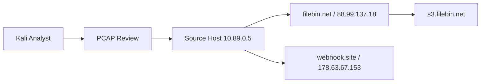

# SOC Homelab Investigation

A Linux host pulled `install.sh` from `filebin.net` with `curl`. The script unpacked a Python payload that sent the host's environment variables to `webhook.site`. I worked through the packet capture, recovered the payload, and decoded the outbound request. It contained an `API_KEY`, so this is credential theft and not just a suspicious download.

## Setup

- Kali Linux VM on VMware
- Evidence: one packet capture from a Linux host
- Tools: Wireshark, `tshark`, `tcpdump`, Nmap, ATT&CK Navigator

## Case details

- Internal source IP: `10.89.0.5`
- External IPs: `88.99.137.18`, `178.63.67.153`
- Domains: `filebin.net`, `s3.filebin.net`, `webhook.site`
- Capture window: February 3, 2025, 14:26:57 to 14:27:00
- Capture: [artifacts/2025-02-03_suspicious-http-download.pcap](./artifacts/2025-02-03_suspicious-http-download.pcap)

## What happened

1. `10.89.0.5` requested `/dqatt7c4cvcc1fc1/install.sh` from `filebin.net` with `curl/7.88.1`.
2. The server returned a `302` redirect to `s3.filebin.net`.
3. The host downloaded `install.sh`.
4. The script piped a Base64 blob to `python`.
5. The Python payload sent an encoded `?x=` parameter to `webhook.site`.
6. Decoding `?x=` gave back the host's environment variables, including `API_KEY`.

## Decoding the exfiltrated data

The payload XORs `str(os.environ)` with a key built from glibc `rand()` and sends the Base64 result as `?x=`. It never seeds `rand()`, so glibc uses its default seed of `1`. That means the key can be rebuilt offline.

[scripts/decode_exfil.py](./scripts/decode_exfil.py) reimplements glibc `rand()`, rebuilds the key, and decodes the request from `tcp-stream-webhook.txt`. The output, with the key value redacted, is in [artifacts/decoded-exfil.txt](./artifacts/decoded-exfil.txt):

| Variable | Value | Why it matters |
|---|---|---|
| `API_KEY` | `[REDACTED]` | A live secret left the host and has to be rotated |
| `HOSTNAME` | `66e2549a6da7` | A container ID, so the payload ran inside a container |
| `container` | `podman` | Podman runtime, process running as `/root` |
| `HTTP_PROXY` / `HTTPS_PROXY` | `10.89.0.6:8080` | Internal proxy whose logs should show the same requests |

## Evidence

`curl` fetching `install.sh` over plain HTTP from `filebin.net`:

The script piping a Base64 blob to `python`:

`python-requests/2.28.1` calling `webhook.site` and getting `200 OK`:

## Findings

| ID | Finding | Severity | Evidence | Response |
|---|---|---|---|---|
| F-01 | Script downloaded over HTTP from `filebin.net` using `curl` | High | `download-request-excerpt.txt`, `http-responses.txt` | Treat the source host as compromised and review execution history |
| F-02 | Downloaded script contained an embedded Python payload | High | `install-script-excerpt.txt`, `decoded_python_payload.py` | Keep the script and check what it collected |
| F-03 | Outbound request sent encoded data to `webhook.site` | High | `webhook-request-excerpt.txt`, `tcp-stream-webhook.txt` | Block the destination and look for other hosts reaching it |
| F-04 | Decoded request contains the host environment, including `API_KEY` | Critical | `decoded-exfil.txt`, `decode_exfil.py` | Rotate the API key and review its use since 2025-02-03 14:27 |

## Files

Artifacts:

- [artifacts/download-request-excerpt.txt](./artifacts/download-request-excerpt.txt)
- [artifacts/install-script-excerpt.txt](./artifacts/install-script-excerpt.txt)
- [artifacts/webhook-request-excerpt.txt](./artifacts/webhook-request-excerpt.txt)
- [artifacts/http-requests.txt](./artifacts/http-requests.txt)
- [artifacts/http-responses.txt](./artifacts/http-responses.txt)
- [artifacts/tcp-stream-install.txt](./artifacts/tcp-stream-install.txt)
- [artifacts/tcp-stream-webhook.txt](./artifacts/tcp-stream-webhook.txt)
- [artifacts/decoded_python_payload.py](./artifacts/decoded_python_payload.py)
- [artifacts/decoded-exfil.txt](./artifacts/decoded-exfil.txt)

Notes and scripts:

- [notes/incident-report.md](./notes/incident-report.md)
- [notes/iocs.md](./notes/iocs.md)
- [notes/attack-mapping.md](./notes/attack-mapping.md)
- [mitre/coverage.md](./mitre/coverage.md)
- [scripts/analyze_pcap.sh](./scripts/analyze_pcap.sh)
- [scripts/decode_exfil.py](./scripts/decode_exfil.py)

## Next steps

Rotate the key now. Treat the container as compromised until its execution history and process activity have been reviewed. Check the proxy logs at `10.89.0.6` for other hosts reaching `filebin.net` or `webhook.site`.
