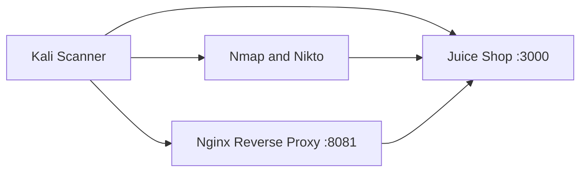
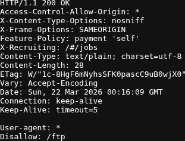
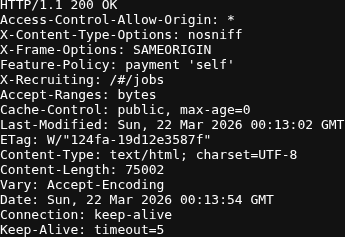
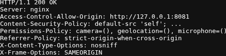
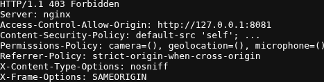

# Vulnerability Management Lab

I scanned OWASP Juice Shop in a local Docker lab and checked each scanner result by hand. Most of Nikto's output turned out to be noise. Three findings held up. I then put the app behind an nginx reverse proxy to fix them without touching the Juice Shop code, and saved the headers and responses from before and after.

## Setup

- Kali Linux VM on VMware
- Target: OWASP Juice Shop in Docker at `http://127.0.0.1:3000`
- Hardened path: nginx reverse proxy at `http://127.0.0.1:8081`
- Tools: `curl`, Nmap, Nikto, Firefox, nginx

Scope was one application, one exposed service, and one retest through the proxy.

## Steps

1. Started Juice Shop and confirmed it was reachable.
2. Ran Nmap and Nikto against it.
3. Checked each result by hand and kept the ones that held up.
4. Put nginx in front of the app with fixes for those findings.
5. Ran the same checks through the proxy and compared.

## Sorting out the scanner noise

Nikto reported a long list of backup files such as `/archive.tar` and `/dump.jks`. None of them exist. Juice Shop is a single-page app and returns the same HTML shell for any path, so every guessed filename "exists" as far as Nikto can tell. I dropped those results instead of reporting them as exposures.

## Findings

| ID | Vulnerability | Severity | Evidence | Fix applied at the proxy |
|---|---|---|---|---|
| V-01 | `robots.txt` lists `/ftp/` and the route is directly reachable | Medium | `robots-response.txt`, `validation-baseline-ftp-head.txt`, `validation-hardened-robots.txt`, `validation-hardened-ftp-head.txt` | Cleaned `robots.txt` and blocked `/ftp/` |
| V-02 | Responses include `Access-Control-Allow-Origin: *` | Low | `http-headers.txt`, `validation-hardened-http-headers.txt` | Limited the allowed origin to the proxy host |
| V-03 | No `Content-Security-Policy` header | Low | `http-headers.txt`, `validation-hardened-http-headers.txt` | Added CSP and other browser security headers |

V-01 is the one that matters. It points to a sensitive-looking path, and that path is open. V-02 is lower risk here because I didn't test any logged-in cross-origin flow. V-03 is a missing hardening layer, not a sign of compromise.

## Fixing it at the proxy

[hardening/nginx.conf](./hardening/nginx.conf) applies four controls:

- serves a `robots.txt` without `/ftp/`
- returns `403 Forbidden` for `/ftp/`
- rewrites `Access-Control-Allow-Origin` from `*` to the proxy origin
- adds `Content-Security-Policy`, `Permissions-Policy`, and `Referrer-Policy`

| Check | Direct (`:3000`) | Through proxy (`:8081`) |
|---|---|---|
| `/ftp/` | `200 OK` | `403 Forbidden` |
| `/robots.txt` | lists `/ftp/` | cleaned |
| CORS origin | `*` | proxy origin only |
| CSP | missing | present |

These are compensating controls. Juice Shop itself is unchanged.

## Evidence

Baseline `robots.txt` listing `/ftp/` (V-01):

Baseline headers with `Access-Control-Allow-Origin: *` and no CSP (V-02, V-03):

Headers through the proxy, with a narrower origin and CSP added:

The proxy returning `403 Forbidden` for `/ftp/`:

## If this were production

1. Fix these in the application itself, not only at the proxy.
2. Take sensitive paths out of `robots.txt`.
3. Restrict CORS to the origins that need it.
4. Keep CSP and review the other browser security headers.
5. Retest and compare headers and routes again.

## Files

Artifacts:

- [artifacts/http-headers.txt](./artifacts/http-headers.txt)
- [artifacts/nmap-initial.txt](./artifacts/nmap-initial.txt)
- [artifacts/nikto-initial.txt](./artifacts/nikto-initial.txt)
- [artifacts/robots-response.txt](./artifacts/robots-response.txt)
- [artifacts/ftp-head.txt](./artifacts/ftp-head.txt)
- [artifacts/archive-head.txt](./artifacts/archive-head.txt)
- [artifacts/validation-baseline-http-headers.txt](./artifacts/validation-baseline-http-headers.txt)
- [artifacts/validation-baseline-robots.txt](./artifacts/validation-baseline-robots.txt)
- [artifacts/validation-baseline-ftp-head.txt](./artifacts/validation-baseline-ftp-head.txt)
- [artifacts/validation-hardened-http-headers.txt](./artifacts/validation-hardened-http-headers.txt)
- [artifacts/validation-hardened-robots.txt](./artifacts/validation-hardened-robots.txt)
- [artifacts/validation-hardened-ftp-head.txt](./artifacts/validation-hardened-ftp-head.txt)
- [artifacts/validation-summary.md](./artifacts/validation-summary.md)

Scripts and config:

- [mitre/defensive-context.md](./mitre/defensive-context.md)
- [scripts/run_discovery.sh](./scripts/run_discovery.sh)
- [scripts/run_hardening_validation.sh](./scripts/run_hardening_validation.sh)
- [hardening/nginx.conf](./hardening/nginx.conf)
