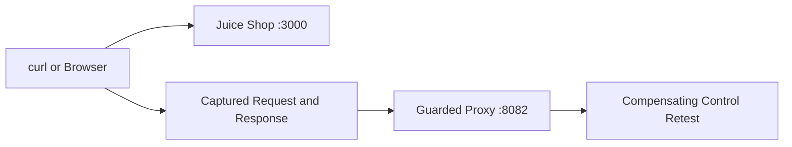
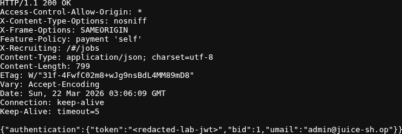
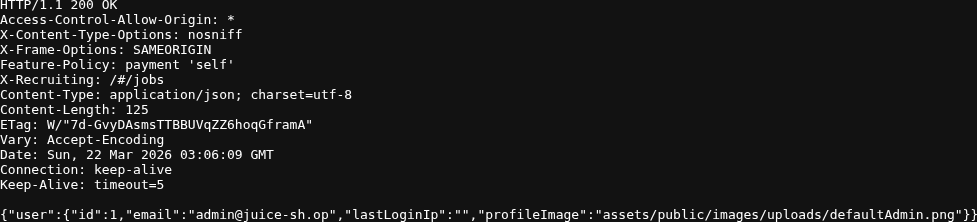
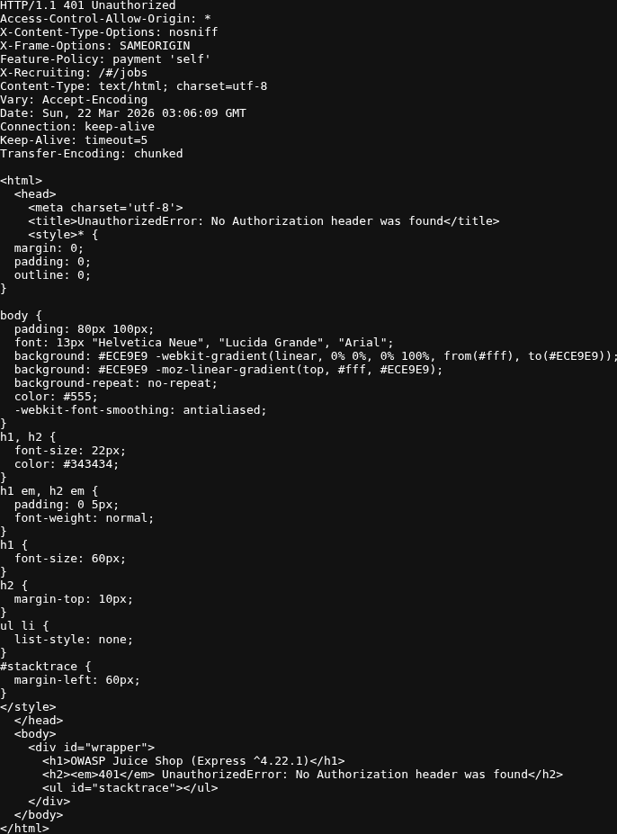
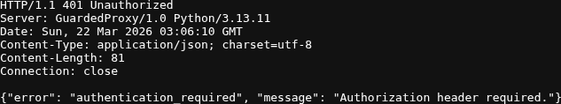

# Web Application Pentest Lab

Two findings against OWASP Juice Shop, each backed by the saved HTTP request and response. A SQL injection in the login API logs you in as admin. An unauthenticated request to `/api/Users` returns an error page that names the framework and version. I then retested both through a small Python proxy that blocks them.

## Setup

- Kali Linux VM on VMware
- Target: OWASP Juice Shop at `http://127.0.0.1:3000`, local lab only
- Tools: `curl`, Chromium/Firefox, a small Python proxy, and optionally Burp Suite Community Edition or OWASP ZAP

## Scope

- `POST /rest/user/login`
- `GET /rest/user/whoami`
- `GET /api/Users`

I only tested these three endpoints. This is not a full application test.



## Steps

1. Started Juice Shop.
2. Sent a SQL injection payload in the `email` field of `/rest/user/login`.
3. Replayed the returned token against `/rest/user/whoami` to confirm it belonged to the admin account.
4. Called `/api/Users` without a session and saved the error page.
5. Put the guarded proxy on port 8082 in front of the app and repeated both tests.

To reproduce:

```bash
./scripts/start_target.sh
./scripts/run_validation.sh
```

## Findings

| ID | Finding | Severity | Evidence | Mitigation |
|---|---|---|---|---|
| W-01 | SQL injection in the login API bypasses authentication as admin | High | `finding-sqli-login-bypass.txt`, `finding-sqli-whoami.txt`, `retest-sqli-login-blocked.txt` | Parameterized queries in the application; the proxy blocked obvious injection markers during the retest |
| W-02 | Unauthenticated `/api/Users` returns a verbose error page that discloses the framework | Low | `baseline-api-users-verbose.txt`, `retest-api-users-generic-401.txt` | Return a generic 401 and hide framework and version details |

| Test | Direct (`:3000`) | Through proxy (`:8082`) |
|---|---|---|
| SQL injection login | `200 OK` with an admin token for `admin@juice-sh.op` | `403 Forbidden` |
| Unauthenticated `/api/Users` | Verbose Express error page | Minimal JSON `401` |

The proxy is a compensating control. Juice Shop itself is not patched.

## Evidence

The injected login returning `200 OK` with an admin token:


The same token resolving to the admin account:


`/api/Users` without a session, disclosing `OWASP Juice Shop (Express ^4.22.1)`:


The retest through the proxy returning a generic JSON `401`:


The blocked SQL injection retest is in [artifacts/retest-sqli-login-blocked.txt](./artifacts/retest-sqli-login-blocked.txt). In the login bypass artifact, the real JWT is replaced with `<redacted-lab-jwt>`.

## Files

Artifacts:

- [artifacts/baseline-api-users-verbose.txt](./artifacts/baseline-api-users-verbose.txt)
- [artifacts/baseline-login-invalid.txt](./artifacts/baseline-login-invalid.txt)
- [artifacts/finding-sqli-login-bypass.txt](./artifacts/finding-sqli-login-bypass.txt)
- [artifacts/finding-sqli-whoami.txt](./artifacts/finding-sqli-whoami.txt)
- [artifacts/retest-sqli-login-blocked.txt](./artifacts/retest-sqli-login-blocked.txt)
- [artifacts/retest-api-users-generic-401.txt](./artifacts/retest-api-users-generic-401.txt)
- [artifacts/validation-summary.md](./artifacts/validation-summary.md)

Notes and scripts:

- [notes/finding-notes.md](./notes/finding-notes.md)
- [scripts/start_target.sh](./scripts/start_target.sh)
- [scripts/check_target.sh](./scripts/check_target.sh)
- [scripts/run_validation.sh](./scripts/run_validation.sh)
- [scripts/start_guarded_proxy.sh](./scripts/start_guarded_proxy.sh)
- [scripts/stop_guarded_proxy.sh](./scripts/stop_guarded_proxy.sh)
- [scripts/guarded_proxy.py](./scripts/guarded_proxy.py)
